# Trelis implementation ticket connections

The implementation tickets use tracer-bullet vertical slices. The two early
probes gate bulk component work; all component slices gate the complete
platform regression matrix, which in turn gates whole-library NVDA
qualification.

The tickets themselves contain the authoritative acceptance criteria and
blocking lists. This document is a navigation view.

```mermaid
flowchart TD
    T01["Prove the terminal backend<br/>and restoration lifecycle"]
    T02["Prove editable defaults and<br/>shared Windows + NVDA interaction"]
    T03["Deliver TextInput and the shared<br/>public prompt-session foundation"]

    T01 --> T02 --> T03

    subgraph Text["Text and structured input"]
        T04["Password"]
        T05["Multiline"]
        T06["Autocomplete"]
        T07["TagInput"]
        T21["NumberInput"]
        T22["PortInput and IPAddressInput"]
        T23["URLInput and EmailInput"]
        T24["ColorInput"]
        T25["MaskedInput"]
        T26["DurationInput"]
        T27["DateInput"]
        T28["CronInput"]
    end

    T03 --> T04
    T03 --> T05
    T03 --> T06
    T03 --> T07
    T03 --> T21
    T03 --> T22
    T03 --> T23
    T03 --> T24
    T03 --> T25
    T03 --> T26
    T03 --> T27
    T03 --> T28

    subgraph Choices["Choice, search, hierarchy, and ordering"]
        T08["Confirm, Checkbox, and Toggle"]
        T09["Select and Radio"]
        T10["MultiSelect"]
        T11["SearchSelect"]
        T12["CommandPalette"]
        T13["TimezoneSelect"]
        T14["TreeSelect"]
        T15["SortableSelect"]
    end

    T03 --> T08
    T03 --> T09
    T09 --> T10
    T06 --> T11
    T09 --> T11
    T11 --> T12
    T11 --> T13
    T09 --> T14
    T09 --> T15

    subgraph Specialized["Specialized values and key capture"]
        T16["Slider and RangeSlider"]
        T17["TimeInput"]
        T18["PathInput"]
        T19["FilePicker and DirectoryPicker"]
        T20["Keypress and KeyChordInput"]
    end

    T03 --> T16
    T03 --> T17
    T03 --> T18
    T09 --> T19
    T18 --> T19
    T03 --> T20

    subgraph Feedback["Feedback components"]
        T29["Text, Progress, and Spinner"]
        T30["MultiSpinner"]
    end

    T03 --> T29
    T29 --> T30

    T31["Run the complete automated<br/>Windows/macOS/Linux regression matrix"]
    T32["Qualify the whole library with<br/>Windows Terminal + NVDA"]

    T04 --> T31
    T05 --> T31
    T06 --> T31
    T07 --> T31
    T08 --> T31
    T09 --> T31
    T10 --> T31
    T11 --> T31
    T12 --> T31
    T13 --> T31
    T14 --> T31
    T15 --> T31
    T16 --> T31
    T17 --> T31
    T18 --> T31
    T19 --> T31
    T20 --> T31
    T21 --> T31
    T22 --> T31
    T23 --> T31
    T24 --> T31
    T25 --> T31
    T26 --> T31
    T27 --> T31
    T28 --> T31
    T29 --> T31
    T30 --> T31

    T31 --> T32
```

## Main sequence

**Terminal lifecycle probe → editable-default/NVDA probe → TextInput foundation
→ component slices → complete platform regression matrix → whole-library NVDA
qualification**

## Component dependency shortcuts

- Autocomplete + Select/Radio → SearchSelect.
- Select/Radio + PathInput → filesystem pickers.
- SearchSelect → CommandPalette and TimezoneSelect.
- Select/Radio → MultiSelect, TreeSelect and SortableSelect.
- Text/Progress/Spinner → MultiSpinner.
- Every component ticket 04–30 blocks the complete regression matrix.
- The regression matrix blocks the final whole-library NVDA qualification.

The early NVDA probe and final qualification are human-gated. The other tickets
are agent-ready once their blockers are complete.

## Ticket index

1. [Prove the terminal backend and restoration lifecycle](issues/01-terminal-backend-lifecycle-probe.md)
2. [Prove editable defaults and shared Windows + NVDA interaction](issues/02-editable-default-nvda-probe.md)
3. [Deliver TextInput and the shared public prompt-session foundation](issues/03-text-input-session-foundation.md)
4. [Deliver Password](issues/04-password.md)
5. [Deliver Multiline](issues/05-multiline.md)
6. [Deliver Autocomplete](issues/06-autocomplete.md)
7. [Deliver TagInput](issues/07-tag-input.md)
8. [Deliver Confirm, Checkbox, and Toggle](issues/08-boolean-components.md)
9. [Deliver Select and Radio](issues/09-select-radio.md)
10. [Deliver MultiSelect](issues/10-multi-select.md)
11. [Deliver SearchSelect](issues/11-search-select.md)
12. [Deliver CommandPalette](issues/12-command-palette.md)
13. [Deliver TimezoneSelect](issues/13-timezone-select.md)
14. [Deliver TreeSelect](issues/14-tree-select.md)
15. [Deliver SortableSelect](issues/15-sortable-select.md)
16. [Deliver Slider and RangeSlider](issues/16-sliders.md)
17. [Deliver TimeInput](issues/17-time-input.md)
18. [Deliver PathInput](issues/18-path-input.md)
19. [Deliver FilePicker and DirectoryPicker](issues/19-filesystem-pickers.md)
20. [Deliver Keypress and KeyChordInput](issues/20-key-capture.md)
21. [Deliver NumberInput](issues/21-number-input.md)
22. [Deliver PortInput and IPAddressInput](issues/22-port-ip-inputs.md)
23. [Deliver URLInput and EmailInput](issues/23-url-email-inputs.md)
24. [Deliver ColorInput](issues/24-color-input.md)
25. [Deliver MaskedInput](issues/25-masked-input.md)
26. [Deliver DurationInput](issues/26-duration-input.md)
27. [Deliver DateInput](issues/27-date-input.md)
28. [Deliver CronInput](issues/28-cron-input.md)
29. [Deliver Text, Progress, and Spinner](issues/29-text-progress-spinner.md)
30. [Deliver MultiSpinner](issues/30-multi-spinner.md)
31. [Run the complete automated Windows/macOS/Linux regression matrix](issues/31-cross-platform-regression-matrix.md)
32. [Qualify the whole library with Windows Terminal + NVDA](issues/32-whole-library-nvda-qualification.md)
